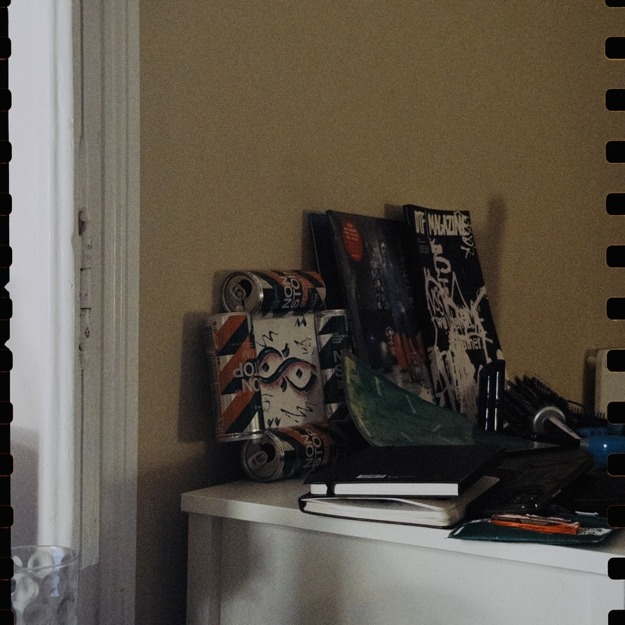
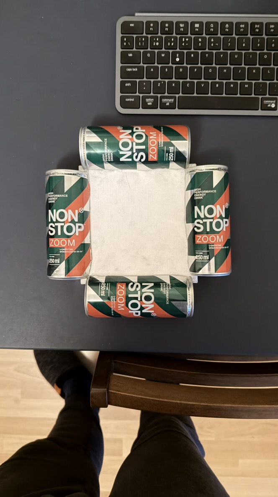
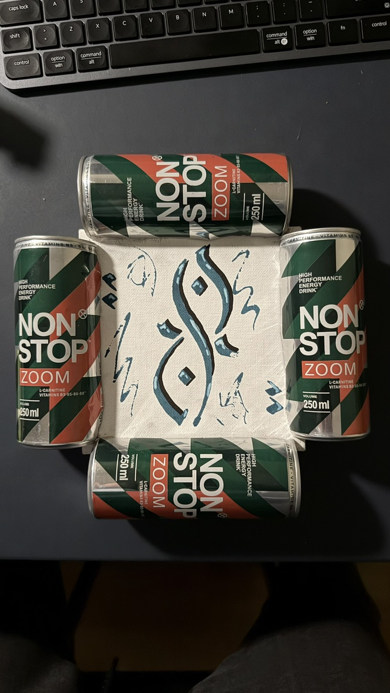
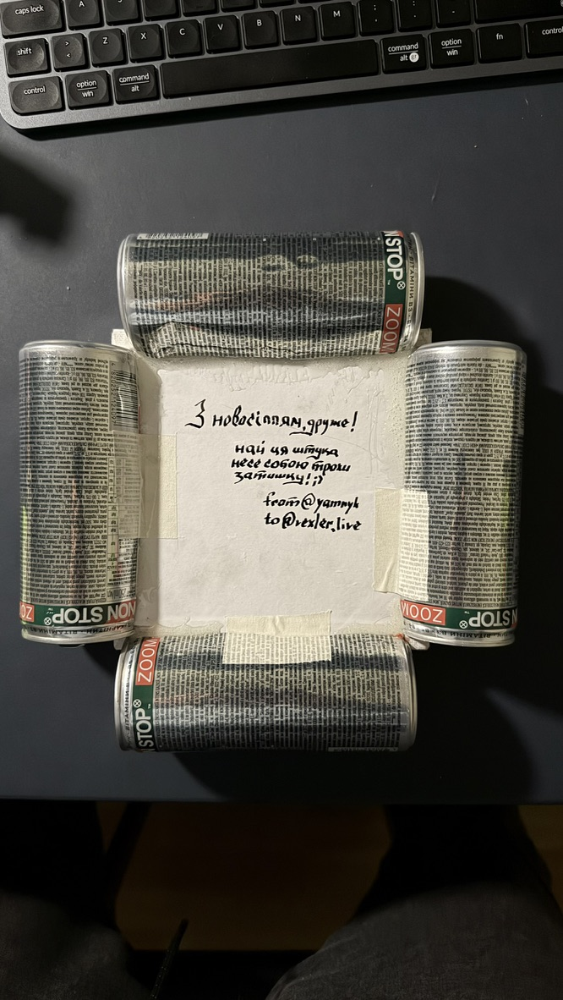
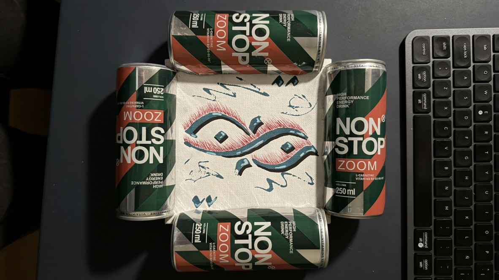

# Картина в рамці з НОНСТОП-ів для Олексія

Довго думав що подарувати на новосілля, і згадав нашу розмову про DYI-ні штуки які б робити в кімнати затишніше. Тому було прийняте вольове рішення зробити щось руками.

Сама ідея з банками прийшла трошки згодом, коли я згадав про кіпу банок на антрісолі, які чекали на свій проєкт.
2 комплекти по 4 штуки однакових банок. Вибрав різдвяні. бо уже і наближається, та і в цілому виглядало якось цікавіше чи шо.

## Stage 1 - рамка

Орієнтовно за 30-40 хвилин народилось оце:

Відчувалось наче пройшло 4 дні і 4 ночі, бо кожна банка по-своєму не давалась то різатись то ставати на місце, то просто вийожувалась як могла.

## Stage 2 - епоксидка (куда ж без неї)

Все проклеїлось епоксидкою з задньої сторони, бо трималось воно, чесно кажучи, на чесному слові. Епоксидка - звичайний 2-компонентний шприц із смолою та затверджувачем.
За ніч все застило як треба, хоча на упаковці писало чи 5 чи 30 хвилин. в що я ніколи і ні разу не вірив.

шататиь-коливатись перестало і на тому радість!

## Stage 3 - малювалка

Думав спочатку шось акрилом мудрити, але взяв в руки пензля і поняв шо мені ттттак впадлу, якшо чесно оце з фарбами возитись!
Того відразу гадалось про каліграфну ручку 6мм завширшки в якій, так вже сталось випадково, була паста потрібного під цю картину кольору.

- та це ж доленька! - подумав я, і прийнявся малювати.

Абсолютно не маючи ніякого задуму і системи. я просто вознув ручкою, як душі велось.
Повелось добротно, виходить, бо домалювалось відразу "симетричне" відображення і не вистачало лише пари штрихів.
Додав штрихи абсолютно не думаючи куда і шо я пляцкаю, і вийшло оце:

  
  

Тут же придумався і підпис, який зайняв місце на звороті.
Якшо придивитись, то можна помітити як на фото епоксидка ззаду тримається на такому ж чесному слові, як банки самі. Але по відчуттям наче дійсно допомагає.

## Stage 4 - штрих-штрих

Глянувши на ето веліколєпіє, мені стало цікаво а шо буде. якшо спробувати додати схожий контраст кольорів як на банках.
Тому червогою звичайною шариковою ручкою, прийнявся штрихувати всьо шо штрихуєцця, і вийшл оце чудо:

## Finita la comedia

Через те шо я таскав весь день цю штуку в рюкзаку по Лісабону, я був впевнений шо шось помнеться.
Тому придумав, що пан Олексій може покотойобити ті банки як йому сподобаєтсья, як захоче, і це буде завершальним етапом, який може тривати роками якшо не десятиліттями.

Дуже сподобалась ця ідея, тому при врученні так і сказав.

Також як, власне, з усіма моїми картинами, у отримувача був вибір яким боком в яку сторону її перевертати, тому вибране остаточне роозміщення виглажяє отак:

